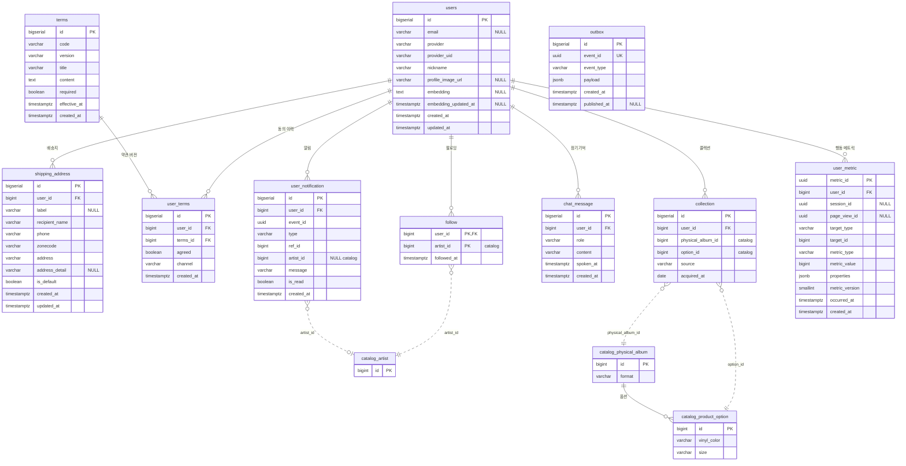

# member-service v2 리팩토링 설계

> **상태: 운영 배포 완료 (2026-11-13).** main `db0df58`(member) · `7aacd38`(Gateway)이 ArgoCD로 배포되어 `api.indig.co.kr`에서 v2 API가 응답합니다. 운영 DB의 `member` 스키마는 비우고 V1 · V2로 다시 만들었습니다(11.1).
> member는 2026-11-12에 구현했고(테스트 156건 통과), 2026-11-13에 Gateway 수정(테스트 124건 통과)과 낡은 코드 정리(10.6)를 더했습니다.
> 2026-11-13(오후): 마이그레이션을 **V1(구조) · V2(값) 두 파일**로 합쳤고(5장), 관리자(Studio CS)용 회원 조회 내부 API를 더했습니다(7장). 테스트 162건 통과.
> 전 서비스 공통의 남은 일은 `indie-msa/docs/v2_후속_작업.md`, 전체 API는 `indie-msa/docs/v2_API_명세서.md`, 프론트 확인 사항은 `indie-msa/docs/v2_프론트_체크사항.md`에 있습니다.
> 이 문서가 member v2의 기준입니다. 구현하면서 설계와 달라진 부분은 본문에 반영했고, 10.5에 따로 모았습니다.
> 마지막 장(12장)에 아직 정하지 않은 항목과 배포 전에 확인할 항목을 모아 두었습니다.

## 0. 한눈에 보기

- member는 **사용자 전용** 서비스입니다. 관리자는 별도 관리자 DB, ID/비밀번호, OTP로 로그인합니다. 그래서 member에는 역할(role) 컬럼이 없고, 토큰의 `roles`는 코드에서 `["USER"]`로 고정합니다.
- 테이블은 10개입니다: `users`, `shipping_address`, `terms`, `user_terms`, `follow`, `collection`, `chat_message`, `user_notification`, `user_metric`, `outbox`.
- **회원 탈퇴는 hard delete입니다.** member의 데이터는 CASCADE로 모두 지우고, 다른 서비스에는 `user.withdrawn` 이벤트로 알립니다. 탈퇴를 막는 조건은 없고, 재가입도 바로 할 수 있습니다.
- **알림:** Kafka 이벤트를 받는 즉시 팔로워들의 `user_notification`에 복사합니다. 원본 소식 테이블은 두지 않습니다. 읽음은 행마다 처리하고, 3개월 동안 보관합니다.
- **행동 메트릭:** 프론트가 member 수집 API로 보내고, 6개월 동안 보관합니다. AI는 필터 조회 API로 읽습니다.
- **장바구니는 catalog로 옮깁니다.** member의 `wishlist`는 삭제합니다.
- **마이그레이션:** 파일은 `V1__member_schema.sql`(구조) · `V2__member_values.sql`(값 목록 CHECK · 약관 본문) 두 개입니다. 예전 V1~V14를 합친 것이라, 기존 DB는 `member` 스키마를 비우고 다시 올립니다(5장).

## 1. 배경과 범위

- indie-msa의 모든 서비스가 테이블을 대대적으로 개편하는 중이고, member가 첫 번째입니다.
- 운영 상태(2026-11-12 확인): `origin/main`에 V1~V12가 커밋되어 있고, 11/08 main CI가 성공한 뒤 ArgoCD가 배포했습니다. V11은 `users.chat_history` JSONB 버전입니다. 개발 중이라 실데이터가 없으므로 데이터를 옮기는 작업은 하지 않습니다. (2026-11-13: V1~V14를 두 파일로 합쳤습니다. 5장)
- 범위
  - 포함: member 스키마·코드 전체, 다른 서비스와 프론트에 요청할 계약(이벤트·API)
  - 제외: 다른 서비스의 구현(요청 사항만 8장에 정리), 배송 처리 흐름(MVP 제외, 배송지 저장만 유지)

## 2. 테이블 정의 (확정)

NULL·기본값 칸이 비어 있으면 NOT NULL입니다. "→ catalog"처럼 다른 서비스를 가리키는 컬럼은 **FK 없이 ID 값만** 저장합니다(논리 참조).
users를 참조하는 FK는 모두 `ON DELETE CASCADE`입니다.

### users (변경)

| 컬럼 | 타입 | NULL·기본값 | 설명 |
|---|---|---|---|
| id | BIGSERIAL | | PK |
| email | VARCHAR(255) | NULL | 카카오 이메일 미동의 시 NULL |
| provider | VARCHAR(16) | | KAKAO, GOOGLE |
| provider_uid | VARCHAR(128) | | 소셜 계정 식별자 |
| nickname | VARCHAR(32) | | |
| profile_image_url | VARCHAR(512) | NULL | |
| embedding | TEXT | NULL | 회원 벡터. pgvector 텍스트 형식 `'[0.1,-0.2,…]'` (6.6) |
| embedding_updated_at | TIMESTAMPTZ | NULL | 벡터 생성 시각 |
| created_at | TIMESTAMPTZ | now() | |
| updated_at | TIMESTAMPTZ | now() | |

삭제하는 컬럼: `status`(hard delete라 불필요), `roles`(사용자 전용), `chat_history`(`chat_message`로 분리)

### shipping_address (유지)

| 컬럼 | 타입 | NULL·기본값 | 설명 |
|---|---|---|---|
| id | BIGSERIAL | | PK |
| user_id | BIGINT | | FK users |
| label | VARCHAR(20) | NULL | 집, 회사 |
| recipient_name | VARCHAR(20) | | |
| phone | VARCHAR(20) | | |
| zonecode | VARCHAR(5) | | 카카오 우편번호 |
| address | VARCHAR(200) | | |
| address_detail | VARCHAR(100) | NULL | |
| is_default | BOOLEAN | false | 기본 배송지 |
| created_at | TIMESTAMPTZ | now() | |
| updated_at | TIMESTAMPTZ | now() | |

### terms (유지)

| 컬럼 | 타입 | NULL·기본값 | 설명 |
|---|---|---|---|
| id | BIGSERIAL | | PK |
| code | VARCHAR(16) | | AGE14, TOS, PRIVACY, PRIVACY_POLICY, MARKETING |
| version | VARCHAR(16) | | v1, v2 … |
| title | VARCHAR(100) | | 체크박스 문구 |
| content | TEXT | | 본문(마크다운) |
| required | BOOLEAN | | 필수 동의 여부 |
| effective_at | TIMESTAMPTZ | | 시행 시각 |
| created_at | TIMESTAMPTZ | now() | |

### user_terms (유지)

| 컬럼 | 타입 | NULL·기본값 | 설명 |
|---|---|---|---|
| id | BIGSERIAL | | PK |
| user_id | BIGINT | | FK users |
| terms_id | BIGINT | | FK terms |
| agreed | BOOLEAN | | 동의 / 철회 |
| channel | VARCHAR(16) | | SIGNUP, MY |
| created_at | TIMESTAMPTZ | now() | 동의·철회 시각 |

INSERT만 하는 동의 이력 테이블입니다. 현재 동의 상태는 (회원, 약관 코드)별 마지막 행입니다.

### follow (유지)

| 컬럼 | 타입 | NULL·기본값 | 설명 |
|---|---|---|---|
| user_id | BIGINT | | FK users |
| artist_id | BIGINT | | → catalog.artist |
| followed_at | TIMESTAMPTZ | now() | |

선호 아티스트는 follow로 대신합니다(선호 장르는 저장하지 않음). 가입할 때 1개 이상 팔로우해야 합니다(PR #8).

### collection (변경)

| 컬럼 | 타입 | NULL·기본값 | 설명 |
|---|---|---|---|
| id | BIGSERIAL | | PK |
| user_id | BIGINT | | FK users |
| physical_album_id | BIGINT | | → catalog.physical_album (LP, CD, 카세트) |
| option_id | BIGINT | | → catalog.product_option (블랙, 컬러, 기본) |
| source | VARCHAR(16) | 'MANUAL' | MANUAL, PURCHASE |
| acquired_at | DATE | CURRENT_DATE | |

회원이 가진 **피지컬 앨범을 옵션 단위로** 기록합니다. 옵션은 항상 알 수 있으므로 `option_id`는 NOT NULL입니다. 같은 LP의 블랙반과 컬러반을 둘 다 가지면 2행이 됩니다.

### chat_message (신규)

| 컬럼 | 타입 | NULL·기본값 | 설명 |
|---|---|---|---|
| id | BIGSERIAL | | PK, 저장 순서(FIFO 기준) |
| user_id | BIGINT | | FK users |
| role | VARCHAR(16) | | USER, ASSISTANT |
| content | VARCHAR(200) | | 최대 200자 |
| spoken_at | TIMESTAMPTZ | | 실제 발화 시각 |
| created_at | TIMESTAMPTZ | now() | |

챗봇 장기기억입니다. 회원당 **최대 50행**까지 저장하고, 넘으면 오래된 것부터 지웁니다.

### user_notification (신규)

| 컬럼 | 타입 | NULL·기본값 | 설명 |
|---|---|---|---|
| id | BIGSERIAL | | PK |
| user_id | BIGINT | | FK users |
| event_id | UUID | | Kafka 이벤트 ID (중복 방지) |
| type | VARCHAR(32) | | 알림 종류 10가지. `ref_id`가 무엇의 ID인지도 이 값으로 정해짐 |
| ref_id | BIGINT | | 클릭했을 때 이동할 대상 (type별로 다름) |
| artist_id | BIGINT | NULL | → catalog.artist. 팔로잉 소식 알림에만 채움 |
| message | VARCHAR(200) | | 한 줄 문장. 저장 시점 내용 그대로(스냅샷) |
| is_read | BOOLEAN | false | |
| created_at | TIMESTAMPTZ | now() | |

제목 컬럼과 썸네일 컬럼은 두지 않습니다. 모든 알림이 같은 형식(한 줄 문장 + 이동 대상)입니다. 보관 기간은 **3개월**입니다.

### user_metric (신규)

| 컬럼 | 타입 | NULL·기본값 | 설명 |
|---|---|---|---|
| metric_id | UUID | | PK. 프론트가 만드는 UUIDv7 (재전송 중복 방지) |
| user_id | BIGINT | | FK users |
| session_id | UUID | NULL | 방문 세션 |
| page_view_id | UUID | NULL | 페이지 방문 |
| target_type | VARCHAR(30) | | 대상 종류 6가지 |
| target_id | BIGINT | | target_type별 대상 ID |
| metric_type | VARCHAR(50) | | 행동 종류 9가지 |
| metric_value | BIGINT | | 횟수 또는 ms (metric_type별, 6.5) |
| properties | JSONB | '{}' | 보조 정보 (검색어, 진입 경로) |
| metric_version | SMALLINT | 1 | 메트릭 스키마 버전 |
| occurred_at | TIMESTAMPTZ | | 행동 시각(클라이언트 기준) |
| created_at | TIMESTAMPTZ | now() | 적재 시각 |

로그인한 회원의 행동만 저장하고, 보관 기간은 **6개월**입니다.

### outbox (유지)

| 컬럼 | 타입 | NULL·기본값 | 설명 |
|---|---|---|---|
| id | BIGSERIAL | | PK |
| event_id | UUID | | UNIQUE |
| event_type | VARCHAR(64) | | `user.withdrawn` 등 |
| payload | JSONB | | |
| created_at | TIMESTAMPTZ | now() | |
| published_at | TIMESTAMPTZ | NULL | NULL = 아직 발행 안 됨 |

### 삭제하는 테이블

| 테이블 | 이유 |
|---|---|
| wishlist | 장바구니로 바꾸고 catalog의 `cart_item`으로 옮김 |
| activity | 팔로잉 소식은 받는 즉시 회원 알림으로 복사함. 아티스트 상세 화면의 소식은 catalog와 concert가 보여줌 |
| user_notification_state | 마지막 확인 시각 방식 대신 행마다 `is_read`로 처리 |

## 3. 키·인덱스 (확정)

| 테이블 | 키·제약 | 인덱스 |
|---|---|---|
| users | UNIQUE(provider, provider_uid) | UNIQUE(email) WHERE email IS NOT NULL |
| shipping_address | | (user_id), UNIQUE(user_id) WHERE is_default |
| terms | UNIQUE(code, version) | |
| user_terms | | (user_id, terms_id, created_at DESC) |
| follow | PK(user_id, artist_id) | (artist_id), (user_id, followed_at DESC, artist_id DESC) |
| collection | UNIQUE(user_id, option_id) | (user_id, id DESC) |
| chat_message | CHECK role, CHECK content 길이 | (user_id, id DESC) |
| user_notification | UNIQUE(user_id, event_id), CHECK type | (user_id, id DESC), (created_at) |
| user_metric | CHECK target_type, CHECK metric_type, CHECK metric_value ≥ 0 | (user_id, occurred_at DESC), (occurred_at) |
| outbox | UNIQUE(event_id) | (id) WHERE published_at IS NULL |

- `(artist_id)`: 알림 복사 때 팔로워를 찾는 데 씁니다.
- `(created_at)`, `(occurred_at)`: 보관 기간이 지난 행을 지우는 배치가 씁니다.
- `UNIQUE(user_id, event_id)`: 같은 이벤트가 다시 들어와도 알림이 두 번 생기지 않게 막습니다.

## 4. enum

DB는 `VARCHAR + CHECK`로, 코드는 Java enum(`@Enumerated(STRING)`)으로 둡니다. PostgreSQL의 ENUM 타입은 값을 지우기 어려워서 쓰지 않습니다.

| 위치 | 값 |
|---|---|
| user_notification.type | ALBUM_RELEASED, EP_RELEASED, SINGLE_RELEASED, PHYSICAL_ALBUM_RELEASED, GOODS_RELEASED, CONCERT_ANNOUNCED, PURCHASE_DONE, PURCHASE_REFUNDED, BOOKING_DONE, BOOKING_CANCELLED |
| user_metric.target_type | ARTIST, ALBUM, TRACK, PHYSICAL_ALBUM, GOODS, CONCERT |
| user_metric.metric_type | DETAIL_VIEW, DWELL, PREVIEW_PLAY, SEARCH_CLICK, RECOMMEND_CLICK, CART_ADD, CART_REMOVE, SHARE, EXTERNAL_LINK_CLICK |
| collection.source | MANUAL, PURCHASE |
| chat_message.role | USER, ASSISTANT |
| user_terms.channel | SIGNUP, MY |
| terms.code | AGE14, TOS, PRIVACY, PRIVACY_POLICY, MARKETING |
| users.provider | KAKAO, GOOGLE |

## 5. 마이그레이션 (V1 구조 · V2 값)

파일은 두 개만 둡니다 (2026-11-13 결정 · 모든 서비스 공통). 예전 V1~V14를 합친 것이고, 합치기 전후의 컬럼 · 제약 · 인덱스와 약관 9행(본문 md5)이 같은지 대조했습니다.

| 파일 | 들어 있는 것 |
|---|---|
| `V1__member_schema.sql` | 테이블 10개, PK · FK · UNIQUE, 인덱스, 구조 CHECK 2개(`ck_chat_message_content` · `ck_user_metric_value`) |
| `V2__member_values.sql` | ① 값 목록 CHECK 4개: `ck_chat_message_role` · `ck_user_notification_type` · `ck_user_metric_target_type` · `ck_user_metric_type` (4장의 enum과 같은 목록) ② 약관 본문 9행: v1(AGE14 · TOS · PRIVACY · MARKETING · PRIVACY_POLICY), v2(PRIVACY · PRIVACY_POLICY), v3(PRIVACY · PRIVACY_POLICY) |

- 약관은 지난 버전까지 모두 넣습니다. 시행일(`effective_at`)이 지난 것 중 가장 최근 버전이 "지금 시행 중"이라, v3(11-21 시행)만 넣으면 그 전까지 시행 중인 약관이 없어 가입이 막힙니다.
- 값 목록을 넣거나 빼면 V2와 Java enum을 함께 고칩니다. `MemberSchemaValuesTest`가 둘을 대조합니다.
- 🔴 **적용된 파일을 고치면 Flyway 체크섬 검증에 걸려 서비스가 뜨지 않습니다.** 실데이터가 없는 지금은 파일을 고친 뒤 `member` 스키마를 비우고 다시 올립니다. 실데이터가 생긴 뒤에는 스키마를 비울 수 없으므로 그때부터는 V3 이후 파일을 이어 붙여야 합니다(12장).
- 기존 DB에 올릴 때: 서비스를 내린 뒤 `DROP SCHEMA member CASCADE` → `terraform/scripts/db-init.sh`(스키마 · 권한 다시 만들기) → 서비스 기동(Flyway가 V1 · V2 적용).

## 6. 로직과 흐름

### 6.1 인증·가입 (바뀌는 부분만)

- 토큰의 `roles` 클레임은 DB에서 읽지 않고 **코드에서 `["USER"]`로 고정**합니다. Gateway의 `X-User-Roles` 헤더 흐름은 그대로입니다.
- 로그인할 때 하던 탈퇴 상태 검사(`checkActive`, `ACCOUNT_WITHDRAWN`)는 없앱니다. 탈퇴한 회원은 행이 없으니, 같은 소셜 계정으로 로그인하면 신규 가입 흐름을 탑니다.
- 가입할 때 아티스트를 1개 이상 팔로우해야 하는 규칙(PR #8)은 유지합니다.

### 6.2 회원 탈퇴 (hard delete)

```
DELETE /api/members/me (CSRF)
 └ 트랜잭션
    ├ outbox INSERT  user.withdrawn { userId, withdrawnAt }
    └ DELETE FROM users WHERE id = :me     → CASCADE로 member 테이블의 회원 데이터 모두 삭제
 └ 커밋 후
    ├ Redis: 리프레시 토큰·세션, 배지 캐시(member:badge:{id}) 삭제
    └ outbox relay → Kafka user.withdrawn → catalog·concert·AI가 각자 정리
```

- **탈퇴를 막는 조건이 없습니다.** 배송은 MVP에서 빠졌고, 결제는 토스 즉시 결제라 결제 대기 상태를 고려하지 않습니다. 결제 대기 중인 주문이나 예매는 각 서비스가 `user.withdrawn`을 받았을 때 취소합니다.
- **재가입은 바로 할 수 있습니다.** 새 `users.id`가 발급되고, 예전 주문이나 예매와는 연결되지 않습니다.
- 다른 서비스에 남는 확정 주문·결제·예매 기록은 법정 보관 대상이라 지우지 않습니다(8장).
- **탈퇴한 브라우저의 인증 쿠키는 Gateway가 지웁니다.** `DELETE /api/members/me`가 성공(2xx)하면 Gateway가 응답에 AT·RT·XSRF 만료 쿠키를 붙입니다(`WithdrawalCookieFilter`). 실패한 응답에는 붙이지 않습니다.
- 다른 기기에 남아 있는 액세스 토큰은 만료(최대 30분)될 때까지 서명 검증을 통과합니다. 리프레시 토큰은 모두 폐기되어 갱신은 안 되고, 그동안 member로 들어오는 요청은 회원 행이 없어서 404가 됩니다. 다른 서비스 요청까지 막을지는 12장에 남겨 두었습니다.

### 6.3 알림

**흐름**

```
수집 CronJob → Gateway /ingest/** (HMAC) → catalog·concert IngestService
  → 새로 생성된 경우에만 같은 트랜잭션에서 outbox 행 추가 → relay → Kafka
  → member 컨슈머 (group member-service, 수동 ack)
     → EventEnvelope 파싱 (필수값이 없으면 DLT로)
     → user_notification INSERT (아래) → 커밋 → ack
     → 실패해서 다시 오면 UNIQUE(user_id, event_id)로 중복 없이 처리됨
회원이 새로고침 → 목록 조회 → 클릭하면 읽음 처리 후 이동
```

**팔로잉 소식: 팔로워에게 바로 복사**

```sql
-- HQL(insert … select … on conflict)이 실제로 만드는 SQL입니다 — 아티스트 1명당 한 문장
insert into member.user_notification (user_id, event_id, type, ref_id, artist_id, message)
select f.user_id, ?, ?, ?, f.artist_id, ?
from member.follow f
where f.artist_id = ?
on conflict on constraint uq_user_notification_event do nothing
```

- 아티스트 1명당 SQL 한 문장이고, 이벤트 하나를 트랜잭션 하나로 처리합니다. JPA `saveAll`은 쓰지 않습니다(IDENTITY 키라 배치 insert가 되지 않음).
- 앨범·굿즈 소식은 아티스트가 1명이라 한 문장입니다. **페스티벌은 라인업 순서대로 아티스트마다 이 문장을 실행합니다.** 먼저 넣은 행이 있으면 뒤 문장은 건너뛰므로(`UNIQUE(user_id, event_id)`), 여러 팀을 팔로우한 회원도 알림은 1건이고 `artist_id`에는 라인업 순서가 가장 앞인 팀이 들어갑니다. 처음 설계의 `DISTINCT ON` + `array_position`(PostgreSQL 전용)을 쓰지 않고 같은 결과를 냅니다.
- 팔로우한 **이후**에 온 소식만 받습니다. 지난 소식을 채워 넣지 않습니다.
- 팔로잉 소식에는 **마케팅 동의가 필요 없습니다**(결정). 팔로워 전원에게 보냅니다.
- 탈퇴 회원은 follow 행이 이미 CASCADE로 지워져서 대상에 들어가지 않습니다.
- 팔로워가 수만 명을 넘으면 user_id 범위로 나눠서 실행합니다.

**개인 알림:** catalog 주문 이벤트와 concert 예매 이벤트의 `userId`로 1행을 넣습니다. payment 이벤트는 쓰지 않습니다. payment payload에는 상품명이 없기 때문입니다.

**type별 이동 대상과 문장 예시**

| type | target | ref_id | message 예시 |
|---|---|---|---|
| ALBUM_RELEASED | ALBUM | album_id | 새소년 정규 2집 「비적응」 발매 · 11/12 |
| EP_RELEASED | ALBUM | album_id | 새소년 EP 「여름깃」 발매 · 11/12 |
| SINGLE_RELEASED | ALBUM | album_id | 새소년 싱글 「자유」 발매 · 11/12 |
| PHYSICAL_ALBUM_RELEASED | PHYSICAL_ALBUM | physical_album_id | 새소년 「비적응」 LP 컬러반 판매 시작 · 45,000원 |
| GOODS_RELEASED | GOODS | goods_id | 새소년 티셔츠 블랙 판매 시작 · 32,000원 |
| CONCERT_ANNOUNCED | CONCERT | concert_id | 펜타포트 2027 라인업 공개 · 8/1~3 · 인천 |
| PURCHASE_DONE | ORDER | 주문 id | 「비적응」 LP 외 1건 주문 완료 · 52,000원 |
| PURCHASE_REFUNDED | ORDER | 주문 id | 「비적응」 LP 외 1건 환불 완료 · 52,000원 |
| BOOKING_DONE | BOOKING | booking_id | 새소년 단독공연 예매 완료 · 12/24(목) 19:00 · 무신사 개러지 |
| BOOKING_CANCELLED | BOOKING | booking_id | 새소년 단독공연 예매 취소 · 12/24 · 77,000원 환불 |

- `target`은 DB에 저장하지 않습니다. `NotificationType` enum이 type과 target의 매핑을 갖고 있고, API 응답에서 풀어서 내려줍니다.
- `message`는 컨슈머가 이벤트 payload로 완성해서 저장합니다. 그래서 아티스트 이름이나 가격이 나중에 바뀌어도 이미 보낸 알림 문장은 그대로입니다.
- 같은 피지컬 앨범에 컬러 옵션이 새로 추가될 때도 `PHYSICAL_ALBUM_RELEASED`를 보냅니다. 굿즈를 색상별로 여러 개 수집하면 알림도 여러 건 갑니다.

**조회와 읽음**
- 목록: `WHERE user_id = :me ORDER BY id DESC`, id 커서로 페이지를 나눕니다. `is_read`는 조건에 넣지 않고 응답 필드로 내려줍니다.
- 단건 읽음: `UPDATE ... SET is_read = true WHERE id = :id AND user_id = :me`
- 전체 읽음: `UPDATE ... SET is_read = true WHERE user_id = :me AND is_read = false`
- 배지: 안 읽은 알림 수를 셉니다. 기존처럼 Redis에 30초 캐시하고, 99개에서 상한을 둡니다. 읽음 처리하면 캐시를 지웁니다.

### 6.4 챗봇 장기기억 (chat_message)

- API 계약(M26 조회, M27 추가)은 기존 `docs/chat-history-api.md`와 같습니다. 바뀌는 것은 저장 위치(`users.chat_history` → `chat_message` 테이블)와 탈퇴 처리입니다.
- 추가 순서: 회원 행 잠금 → 새 메시지 INSERT → 최근 50개를 뺀 나머지 DELETE → 조회. 모두 한 트랜잭션입니다.
- 회원 행을 잠그는 이유: 같은 회원의 동시 저장을 순서대로 처리해서 50개 상한을 지키기 위해서입니다.
- 탈퇴 회원 409(`ACCOUNT_WITHDRAWN`)는 없어집니다. 회원이 없으면 404입니다.
- 응답의 `spokenAt`은 같은 시각을 `+09:00`으로 돌려줍니다(`Z`로 보내도 `+09:00`). TIMESTAMPTZ는 오프셋을 저장하지 않기 때문입니다.

### 6.5 행동 메트릭

**수집:** `POST /api/members/me/metrics`

```json
{
  "events": [
    { "metricId": "01932c6e-7f3a-7b8e-9c1d-2f4a5b6c7d8e",
      "sessionId": "…", "pageViewId": "…",
      "targetType": "PHYSICAL_ALBUM", "targetId": 31,
      "metricType": "DETAIL_VIEW", "metricValue": 1,
      "properties": { "from": "HOME" },
      "occurredAt": "2026-11-12T15:30:00+09:00" }
  ]
}
```

- 한 번에 1~50개를 보냅니다. 회원은 `X-User-Id`로만 정하고, 로그인하지 않은 사용자의 행동은 받지 않습니다.
- `metric_id`가 이미 있으면 무시합니다(`ON CONFLICT DO NOTHING`). 그래서 같은 이벤트를 다시 보내도 됩니다.
- `occurredAt`은 오프셋이 필수입니다. 허용 범위는 받은 시각 기준 **24시간 전 ~ 5분 후**(기본값)입니다. 범위를 벗어난 이벤트는 그것만 버리고 나머지는 저장합니다.
- `properties`에는 보조 정보만 넣습니다. 개인정보(이메일, 쿼리스트링이 붙은 전체 URL 등)는 넣지 않습니다. JSON 객체만 받고, 직렬화한 길이가 2,000자를 넘으면 400입니다.

**프론트에서 보내는 방식: 모아서 한 번에**

행동이 생길 때마다 바로 보내지 않습니다. 브라우저 메모리의 버퍼에 쌓아 두었다가, 아래 중 하나에 해당하면 한 번에 보냅니다(기본값).

| 보내는 조건 | 방법 |
|---|---|
| 버퍼에 20개가 쌓였을 때 | `fetch` |
| 마지막 전송 후 10초가 지났고 버퍼가 비어 있지 않을 때 | `fetch` |
| 페이지가 숨겨질 때 (`visibilitychange`가 hidden) | `fetch(..., { keepalive: true })` |

- 실패하면(네트워크 오류, 5xx, 429) 버퍼에 남겨 두었다가 다음 전송 때 같이 보냅니다. `metricId`가 같아서 중복 저장되지 않습니다.
- 버퍼는 최대 200개까지 두고, 넘으면 오래된 것부터 버립니다.
- 탭을 닫기 직전의 마지막 전송이 실패하면 그 이벤트는 사라집니다. 메트릭은 추천에 참고하는 데이터라 일부 유실은 허용합니다.
- **Gateway rate limit:** 메트릭 수집 API에 회원 기준으로 **분당 30회** 제한이 걸려 있습니다(한 번에 최대 30회까지 몰아서 보낼 수 있고, 그 뒤로는 2초에 1회). 위 방식이면 보통 분당 6회 이하라 정상 사용에서는 걸리지 않습니다. 넘으면 429 `TOO_MANY_REQUESTS`입니다.

**metric_type별 의미**

| metric_type | 보내는 시점 | target_type | metric_value | properties |
|---|---|---|---|---|
| DETAIL_VIEW | 상세 페이지에 들어올 때 | 전체 | 1 | from |
| DWELL | 상세 페이지를 떠날 때 | 전체 | 머문 시간 ms | |
| PREVIEW_PLAY | 미리듣기를 멈추거나 끝날 때 | TRACK | 재생 시간 ms | |
| SEARCH_CLICK | 검색 결과를 클릭할 때 | 클릭한 대상 | 결과 순위(1부터) | keyword |
| RECOMMEND_CLICK | 추천 카드를 클릭할 때 | 전체 | 1 | source (HOME, CHAT …) |
| CART_ADD / CART_REMOVE | 장바구니에 담거나 뺄 때 | PHYSICAL_ALBUM, GOODS | 수량 | optionId |
| SHARE | 공유할 때 | 전체 | 1 | channel |
| EXTERNAL_LINK_CLICK | 외부 구매처 링크를 클릭할 때 | PHYSICAL_ALBUM, GOODS | 1 | |

팔로우, 콜렉션, 구매, 예매는 메트릭으로 기록하지 않습니다. 각 테이블(서비스)에 이미 정확한 원본이 있습니다.

**AI 조회:** `GET /internal/members/{userId}/metrics`

| 파라미터 | 설명 |
|---|---|
| from, to | 기간(from 이상 to 미만). 오프셋이 붙은 ISO-8601. 생략하면 to는 지금, from은 to의 30일 전. 범위는 최대 6개월(보관 기간) |
| targetType, metricType | 필터. 쉼표로 여러 값 (`metricType=DETAIL_VIEW,DWELL`) |
| aggregate | 기본 true: (대상, metric_type)별 합계. `metric_value` 합이 큰 순, 같으면 최근 순. false면 원본 행(최신순) |
| limit, cursor | limit은 기본 100, 최대 1000(넘으면 1000으로). cursor는 원본 행에서만 |

- 쿼리 문자열에서 `+`는 공백으로 읽힙니다. `+09:00` 오프셋은 `%2B09:00`으로 보내거나 `Z`(UTC)를 쓰세요.

- 허용한 파라미터만 받습니다. member가 회원 단위로 걸러서 주고, AI가 member DB를 직접 읽지 않습니다.
- AI는 member를 직접 부르지 않고 **Gateway의 서명 경로** `GET /ingest/members/{userId}/metrics`로 부릅니다. 기존 `/ingest`와 같은 HMAC 서명이고, 외부(인터넷)에서는 열리지 않습니다. 호출 방법은 7장 "AI가 호출하는 방법"에 있습니다.

### 6.6 회원 벡터

- `users.embedding`은 **TEXT**입니다. AI 담당자가 차원을 아직 정하지 못했기 때문입니다.
- 저장 형식은 **pgvector 텍스트 형식**입니다: `'[0.0123,-0.0456,…]'`. 차원이 정해지면 값을 그대로 둔 채 한 줄로 전환합니다.
  ```sql
  ALTER TABLE users ALTER COLUMN embedding TYPE vector(N) USING embedding::vector(N);
  ```
- 쓰기: `PUT /internal/members/{userId}/embedding`. `[숫자,…]` 형식인지만 검사하고(개수는 검사하지 않음), `embedding_updated_at`을 갱신합니다.
- 읽기: `GET /internal/members/{userId}/embedding`.
- AI는 두 API를 Gateway의 서명 경로 `/ingest/members/{userId}/embedding`으로 부릅니다(7장 "AI가 호출하는 방법").
- 어떤 임베딩 모델로 만들었는지는 AI 서비스가 관리합니다. member에는 모델 컬럼을 두지 않습니다.
- **UserEntity에 매핑하지 않습니다.** 매핑하면 로그인할 때마다 수 KB를 같이 읽게 됩니다. 매핑하지 않은 컬럼은 `ddl-auto: validate`가 검사하지 않습니다.

### 6.7 콜렉션

- 직접 등록(MANUAL): 피지컬 앨범과 옵션을 반드시 같이 받습니다.
- 구매 자동 추가(PURCHASE): catalog **주문 확정 이벤트**의 품목 중 피지컬 앨범 옵션만 넣습니다. 굿즈는 넣지 않습니다. `UNIQUE(user_id, option_id)`가 있어서 같은 이벤트가 다시 와도 중복으로 들어가지 않습니다.
- 지금 쓰는 `payment.completed`(albumIds) 기반 자동 추가는 없앱니다.
- 삭제: 회원이 직접 지울 수 있습니다. 직접 등록한 항목과 구매로 추가된 항목 모두 지울 수 있습니다(7장 API 상세).

### 6.8 배송지

- 구조와 API는 그대로입니다. 회원당 최대 10개, 기본 배송지 1개입니다.
- 배송 처리 흐름은 MVP에 없습니다. 주문할 때 catalog가 그 시점의 주소를 주문에 복사합니다.

### 6.9 약관·개인정보처리방침

- V14에서 PRIVACY v3와 PRIVACY_POLICY v3 행을 추가했습니다. **시행일은 2026-11-21 00:00(KST)**로 넣었습니다(이용약관의 7일 공지 기준으로 잡은 값이라, 실제 배포일에 맞춰 확정이 필요합니다. 12장).
  - GA4 태그 사용: 분석 쿠키, Google 국외 이전·처리 위탁. 지금 "광고·추적 쿠키를 사용하지 않습니다" 문구와 충돌하므로 고칩니다.
  - 행동정보(메트릭) 수집 항목, 목적(개인화 추천), 보관 6개월
  - 위시리스트 → 장바구니, 알림 관련 문구, 탈퇴 시 즉시 파기(hard delete)
- 팔로잉 소식 알림은 마케팅 동의 없이 보냅니다. 마케팅 약관 v1에 "추천 굿즈·음반 소식 안내"라는 문구가 있으니 표현이 어긋나지 않게 다듬습니다.
- 동의를 받는 약관(PRIVACY)의 버전이 올라가면 기존 회원에게 다시 동의를 받아야 하는지 확인이 필요합니다(12장).

### 6.10 정기 삭제 배치

| 대상 | 기준 | 주기 |
|---|---|---|
| user_metric | occurred_at < now() − 6개월 | 하루 1번 |
| user_notification | created_at < now() − 3개월 | 하루 1번 |
| chat_message | 회원당 50개 초과분 | 저장할 때마다(배치 아님) |

- member의 `@Scheduled`로 실행합니다. replica가 2개라 두 번 실행될 수 있지만, 기간 조건 DELETE는 결과가 같아서 별도 락을 두지 않습니다.
- 한 번에 너무 많은 행을 지우지 않도록 나눠서 지웁니다.

## 7. API·이벤트 변경표 (member)

### HTTP API

| 메서드·경로 | v2 |
|---|---|
| GET, PATCH `/api/members/me` | 유지. GET 응답에서 `wishlistCount` 제거 (상세 아래) |
| DELETE `/api/members/me` | **신규** 회원 탈퇴 |
| `/api/members/me/addresses/**` | 유지 |
| `/api/members/follows/**` | 유지 |
| GET, GET `/{id}`, POST `/api/members/collections` | 요청·응답을 `physicalAlbumId`, `optionId` 기준으로 변경 (상세 아래) |
| DELETE `/api/members/collections/{id}` | **신규** 콜렉션 삭제 |
| `/api/members/wishlist/**` | **삭제** (catalog `/api/cart/**`) |
| GET `/api/members/feed` | **삭제** (팔로잉 소식은 알림으로) |
| GET `/api/members/notifications` | 응답 필드 변경. 나의 알림과 아티스트 소식을 한 목록으로 (상세 아래) |
| GET `/api/members/notifications/badge` | 유지 (안 읽은 수) |
| POST `/api/members/notifications/{id}/read` | **신규** 단건 읽음 |
| POST `/api/members/notifications/read` | 의미 변경: 전체 읽음(`is_read` 일괄 UPDATE) |
| `/api/members/terms/**`, `/api/members/me/agreements/**` | 유지 |
| GET, POST `/api/members/me/chat-history` | 유지. 409 `ACCOUNT_WITHDRAWN` 제거 |
| POST `/api/members/me/metrics` | **신규** 메트릭 수집 |
| `/internal/auth/**` | 유지. `roles`는 `["USER"]` 고정 |
| GET `/internal/members/{id}/profile` | 응답에서 `roles`, `status` 제거 |
| GET `/internal/members/{userId}/metrics` | **신규** AI용. AI는 Gateway `GET /ingest/members/{userId}/metrics`로 호출 (HMAC) |
| GET, PUT `/internal/members/{userId}/embedding` | **신규** AI용. AI는 Gateway `GET`, `PUT /ingest/members/{userId}/embedding`으로 호출 (HMAC) |
| GET `/internal/admin/members?q=` · GET `/internal/admin/members/{id}` | **신규(11/13)** 관리자(Studio CS)용 회원 검색 · 조회. 내부 토큰의 `iss`가 `studio`일 때만 |
| GET `/.well-known/jwks.json` | 유지 |

### API 상세 (신규·변경)

- 공통 응답 형식은 기존과 같습니다: `{ "isSuccess", "code", "message", "result" }`. 실패 응답에는 `correlationId`가 붙습니다.
- 목록은 커서 페이지 형식 `{ items, nextCursor, hasNext }`이고, `?cursor=&size=`를 받습니다. size의 기본값과 최대값은 기존 `PageSize` 설정을 따릅니다.
- 에러코드는 아래 "에러코드" 표를 따릅니다.

#### 알림 단건 읽음: `POST /api/members/notifications/{id}/read`

| 항목 | 내용 |
|---|---|
| 인증 | 사용자 AT 쿠키 + CSRF(`X-XSRF-TOKEN`) |
| 경로 변수 | `id`: 알림 ID |
| 요청 본문 | 없음 |
| 처리 | `UPDATE user_notification SET is_read = true WHERE id = :id AND user_id = :me` → 커밋 후 Redis 배지 캐시(`member:badge:{id}`) 삭제 |
| 응답 | 200, `result: { "notificationId": 101, "isRead": true }` |

- **이미 읽은 알림을 다시 읽음 처리해도 200입니다.** 같은 요청을 여러 번 보내도 결과가 같습니다.
- **다른 회원의 알림 ID나 없는 ID는 404입니다.** 회원 조건(`user_id = :me`)을 UPDATE에 같이 걸기 때문에, 남의 알림이 있는지 없는지도 드러나지 않습니다.
- 3개월이 지나 삭제된 알림도 404입니다.

| HTTP | 코드 | 상황 |
|---|---|---|
| 401 | 인증 오류 | 토큰 없음·만료 |
| 403 | `CSRF_*` | CSRF 쿠키·헤더 없음 또는 불일치 (Gateway) |
| 404 | `NOT_FOUND` | 없는 알림, 다른 회원의 알림, 보관 기간이 지나 삭제된 알림 |

#### 회원 탈퇴: `DELETE /api/members/me`

| 항목 | 내용 |
|---|---|
| 인증 | 사용자 AT 쿠키 + CSRF(`X-XSRF-TOKEN`) |
| 요청 본문 | 없음 |
| 처리 | 6.2의 흐름. 한 트랜잭션에서 outbox `user.withdrawn` INSERT와 `DELETE FROM users WHERE id = :me`(CASCADE) → 커밋 후 Redis의 리프레시 토큰·세션·배지 캐시 삭제 |
| 응답 | 200, `result: null` |
| 막는 조건 | 없음. 진행 중인 주문이나 예매가 있어도 탈퇴됩니다 (각 서비스가 `user.withdrawn`을 받아 결제 대기 건 취소) |

- 발행 이벤트: `user.withdrawn` `{ "userId": 42, "withdrawnAt": "2026-11-12T15:30:00+09:00" }`
- 탈퇴한 뒤 같은 토큰으로 다시 호출하면 회원 행이 없어서 404입니다.
- **인증 쿠키는 Gateway가 관리합니다.** Gateway가 이 API의 성공 응답에 AT·RT·XSRF 만료 쿠키(`Set-Cookie`, `Max-Age=0`)를 붙여서 로그아웃 상태로 만듭니다. 실패한 응답(401, 403, 404, 5xx)에는 붙이지 않습니다.
- 같은 소셜 계정으로 다시 로그인하면 신규 가입으로 처리되고 새 `users.id`가 발급됩니다.

| HTTP | 코드 | 상황 |
|---|---|---|
| 401 | 인증 오류 | 토큰 없음·만료 |
| 403 | `CSRF_*` | CSRF 쿠키·헤더 없음 또는 불일치 (Gateway) |
| 404 | `NOT_FOUND` | 이미 탈퇴한 회원 |

#### 알림 목록: `GET /api/members/notifications?cursor=&size=`

나의 알림(주문·예매)과 아티스트 소식을 **한 목록에 최신순으로** 내려줍니다. 탭을 나누는 필터는 없습니다.

```json
{ "isSuccess": true, "code": "OK", "message": "성공",
  "result": {
    "items": [
      { "id": 101, "type": "PHYSICAL_ALBUM_RELEASED", "target": "PHYSICAL_ALBUM", "targetId": 31,
        "artistId": 7, "message": "새소년 「비적응」 LP 컬러반 판매 시작 · 45,000원",
        "isRead": false, "createdAt": "2026-11-12T15:30:00+09:00" },
      { "id": 99, "type": "BOOKING_DONE", "target": "BOOKING", "targetId": 5521,
        "artistId": null, "message": "새소년 단독공연 예매 완료 · 12/24(목) 19:00 · 무신사 개러지",
        "isRead": true, "createdAt": "2026-11-11T20:01:00+09:00" }
    ],
    "nextCursor": "MTAw", "hasNext": true } }
```

에러: 400 `INVALID_CURSOR`

#### 안 읽은 알림 수: `GET /api/members/notifications/badge`

- 응답: `result: { "count": 3 }`. 99개를 넘으면 99입니다.
- Redis에 30초 동안 캐시하고, 읽음 처리(단건·전체)를 하면 캐시를 지웁니다.

#### 전체 읽음: `POST /api/members/notifications/read`

- 인증: 사용자 AT 쿠키 + CSRF
- 처리: `UPDATE user_notification SET is_read = true WHERE user_id = :me AND is_read = false` → 배지 캐시 삭제
- 응답: 200, `result: null`

#### 내 정보: `GET /api/members/me`

```json
"result": { "userId": 42, "nickname": "새소년팬", "profileImageUrl": "https://…", "email": null,
            "provider": "KAKAO", "followCount": 3, "collectionCount": 5 }
```

`wishlistCount`가 빠집니다. 닉네임 변경 `PATCH`는 그대로입니다.

#### 콜렉션

| API | 요청 | 응답 |
|---|---|---|
| `GET /api/members/collections?cursor=&size=` | | `items: [{ id, physicalAlbumId, optionId, source, acquiredAt }]` |
| `GET /api/members/collections/{id}` | | 항목 1개 |
| `POST /api/members/collections` (CSRF) | `{ "physicalAlbumId": 12, "optionId": 31, "acquiredAt": "2026-11-01" }` (`acquiredAt` 생략 시 오늘) | 저장된 항목 |
| `DELETE /api/members/collections/{id}` (CSRF) | | `result: null` |

- 이미 등록한 옵션을 다시 등록하면 기존 항목을 그대로 돌려줍니다(200). 같은 요청을 여러 번 보내도 결과가 같습니다.
- 삭제는 직접 등록(MANUAL)과 구매 자동 추가(PURCHASE) 모두 할 수 있습니다.
- 응답에는 ID만 있습니다. 앨범 이름과 이미지는 프론트가 catalog에서 조회합니다.
- member는 catalog를 호출하지 않으므로 `physicalAlbumId`와 `optionId`가 서로 맞는지는 검사하지 않습니다. 프론트는 catalog 화면에서 받은 값을 그대로 보냅니다.

에러: 400 `INVALID_REQUEST`, 404 `NOT_FOUND`(없는 항목, 다른 회원의 항목)

#### 메트릭 수집: `POST /api/members/me/metrics`

- 인증: 사용자 AT 쿠키 + CSRF. Gateway rate limit 대상입니다(회원당 분당 30회).
- 요청: 6.5의 `events` 배열(1~50개)
- 응답: 200, `result: { "saved": 48 }`. 이미 저장된 `metricId`와 시각 범위를 벗어난 이벤트는 개수에서 빠집니다.
- 형식 오류(개수, 필수값, enum 값)가 하나라도 있으면 요청 전체를 400으로 거절합니다. 시각 범위만 벗어난 이벤트는 그 이벤트만 버리고 나머지는 저장합니다. 클라이언트 시계가 틀어져서 묶음 전체를 잃는 일을 막기 위해서입니다.

에러: 400 `INVALID_REQUEST`, 429 `TOO_MANY_REQUESTS` (Gateway rate limit)

#### AI용 메트릭 조회: `GET /internal/members/{userId}/metrics`

파라미터는 6.5 표를 따릅니다.

```json
// aggregate=true
"result": { "items": [
  { "targetType": "PHYSICAL_ALBUM", "targetId": 31, "metricType": "DETAIL_VIEW",
    "count": 12, "sum": 12, "lastOccurredAt": "2026-11-12T15:30:00+09:00" } ] }

// aggregate=false (커서 페이지)
"result": { "items": [
  { "metricId": "01932c6e-…", "targetType": "TRACK", "targetId": 880, "metricType": "PREVIEW_PLAY",
    "metricValue": 28000, "properties": {}, "occurredAt": "2026-11-12T15:31:10+09:00" } ],
  "nextCursor": "…", "hasNext": false }
```

에러: 401 `INTERNAL_TOKEN_*`, 400 `INVALID_REQUEST`(기간 6개월 초과, from > to, 모르는 enum), 404 `NOT_FOUND`(회원 없음)

#### 회원 벡터: `GET`, `PUT /internal/members/{userId}/embedding`

| API | 요청 | 응답 |
|---|---|---|
| PUT | `{ "embedding": "[0.0123,-0.0456,…]" }` | `{ "userId": 42, "dimension": 1536, "updatedAt": "…" }` |
| GET | | `{ "userId": 42, "embedding": "[…]" 또는 null, "updatedAt": "…" 또는 null }` |

- 검사: 텍스트가 `[숫자,숫자,…]` 형식인지만 확인합니다(NaN, Infinity는 받지 않음). **숫자 개수는 검사하지 않습니다.** 이 형식이어야 나중에 `vector(N)`으로 한 줄 전환이 됩니다.

에러: 401 `INTERNAL_TOKEN_*`, 400 `INVALID_REQUEST`, 404 `NOT_FOUND`

#### 관리자(Studio)용 회원 조회: `GET /internal/admin/members`, `GET /internal/admin/members/{id}`

Studio의 CS 화면이 부릅니다(Studio 문서 6.6). Gateway를 거치지 않고 Studio가 member를 직접 부릅니다.

| API | 요청 | 응답 |
|---|---|---|
| GET `/internal/admin/members?q=&size=` | `q` 필수(1~255자). 회원 번호 일치 · 이메일 일치(대소문자 무시) · 닉네임 부분 일치 | `[{ "userId", "email", "provider", "nickname", "profileImageUrl", "createdAt" }]` 최근 가입순, 기본 20 · 최대 50건. **이메일은 가려서**(`ab***@example.com`) |
| GET `/internal/admin/members/{id}` | | 같은 모양 1건, 이메일 전체. 없는 회원(탈퇴 포함)은 404 |

- 내주는 것은 본인 확인에 필요한 값뿐입니다. 배송지 · 동의 이력 · 대화 · 행동 기록 · 벡터는 내주지 않습니다.
- 조회만 있습니다. 회원 정보 수정과 탈퇴는 회원 본인만 합니다.
- **내부 토큰 발급자는 경로로 나눕니다.** `/internal/admin/**`는 `app.internal.admin-issuers`(`studio`)만, 그 밖의 `/internal/**`는 `allowed-issuers`(`gateway`)만 받습니다. 관리자 토큰으로 토큰 발급(`/internal/auth/**`)을 부를 수 없고, Gateway 토큰으로 관리자 조회를 부를 수 없습니다.
- 누가 조회했는지는 Studio의 감사 기록에 남습니다(member는 `X-Admin-Id`를 저장하지 않습니다).

에러: 401 `INTERNAL_TOKEN_*`, 400 `INVALID_REQUEST`, 404 `NOT_FOUND`

#### AI가 호출하는 방법 (Gateway 서명 경로)

AI는 member의 `/internal/**`를 직접 부를 수 없습니다(member는 Gateway에서 오는 요청만 받습니다). 아래 Gateway 경로로 부르면 Gateway가 서명을 확인한 뒤 member 내부 API로 넘깁니다. 응답 본문은 member의 응답 그대로입니다.

| 호출 | Gateway 경로 | member 내부 API |
|---|---|---|
| 메트릭 조회 | `GET /ingest/members/{userId}/metrics?…` | `GET /internal/members/{userId}/metrics` |
| 벡터 조회 | `GET /ingest/members/{userId}/embedding` | `GET /internal/members/{userId}/embedding` |
| 벡터 저장 | `PUT /ingest/members/{userId}/embedding` | `PUT /internal/members/{userId}/embedding` |

- **주소:** `http://gateway.indie.svc.cluster.local:8080/ingest/members/…` — 클러스터 안에서만 열립니다. 외부 주소(`api.<도메인>`)로 부르면 서명이 맞아도 404입니다.
- **헤더** (수집 `/ingest`와 같음)

  | 헤더 | 값 |
  |---|---|
  | `X-Ingest-Key-Id` | 회원 데이터 키의 ID |
  | `X-Ingest-Timestamp` | 지금 시각(epoch 초). Gateway 시각과 ±300초 안 |
  | `X-Ingest-Nonce` | 요청마다 새 UUID. 같은 값을 다시 쓰면 401 |
  | `X-Ingest-Signature` | 아래 서명 |

- **서명**

  ```
  base64( HMAC-SHA256( key,
    "{METHOD}\n{경로}[?{쿼리}]\n{timestamp}\n{nonce}\n{hex(sha256(본문))}" ) )
  ```

  - `{METHOD}`는 `GET` 또는 `PUT`입니다. 조회는 본문이 없으니 빈 문자열의 SHA-256(`e3b0c442…b855`)을 넣습니다.
  - 쿼리는 **보내는 문자열 그대로**(인코딩한 상태로) 서명에 넣고, 쿼리가 없으면 `?`도 붙이지 않습니다. `+09:00` 오프셋은 `%2B09:00`으로 보내고 서명에도 `%2B09:00`으로 넣습니다.
  - 벡터 저장은 `Content-Type: application/json`이고 쿼리를 붙일 수 없습니다.
- **키:** 수집 키와 **별개의 회원 데이터 키**를 씁니다. Gateway의 시크릿 파일 이름은 `ingest.member-keys.<키 ID>`(32바이트 이상)입니다. 수집 키(`ingest.keys.*`)로 서명하면 401이고, 회원 데이터 키로 수집 경로에 보내도 401입니다. AI가 수집 키를 갖지 않는다는 기존 규칙(공용 문서 29)을 그대로 지키기 위해서입니다.
- **한도:** 키 하나당 초당 10건(넘으면 429, `Retry-After: 1`), 본문 1 MiB, member 응답 대기 30초(넘으면 504).
- **Gateway가 내는 에러** (member까지 가지 않음)

  | HTTP | 코드 | 상황 |
  |---|---|---|
  | 401 | `INGEST_KEY_ID_INVALID`, `INGEST_TIMESTAMP_INVALID`, `INGEST_NONCE_INVALID`, `INGEST_SIGNATURE_MISSING` | 서명 헤더가 없거나 형식이 틀림 |
  | 401 | `INGEST_SIGNATURE_INVALID` | 서명이 다름, 모르는 키 ID, 다른 묶음의 키 |
  | 401 | `INGEST_REPLAYED` | 시각이 ±300초 밖이거나 nonce 재사용 |
  | 404 | `NOT_FOUND` | 매핑에 없는 경로, 외부에서 온 요청 |
  | 405 | `METHOD_NOT_ALLOWED` | 경로는 맞지만 메서드가 다름 |
  | 400 / 415 | `INVALID_REQUEST` / `UNSUPPORTED_MEDIA_TYPE` | 벡터 저장에 쿼리를 붙임 / JSON이 아님 |
  | 429 | `TOO_MANY_REQUESTS` | 초당 10건 초과 |
  | 503 / 504 | `SERVICE_UNAVAILABLE` / `GATEWAY_TIMEOUT` | member에 연결 실패 / 응답 지연. `Retry-After: 30` |

- 다시 보낼 때는 **새 timestamp와 nonce로 다시 서명**합니다.
- Gateway는 member로 넘길 때 `X-Internal-Token`(`aud=member`, `sub=ingest:{키 ID}`)을 붙이고, 요청 1건마다 키 ID·메서드·경로(회원 ID 포함)·상태를 로그로 남깁니다.

### 에러코드

**새 에러코드는 만들지 않습니다.** 없는 리소스는 `NOT_FOUND`, 형식 오류는 `INVALID_REQUEST`를 씁니다. 기존 코드와 같은 규칙입니다.

| 코드 | HTTP | v2 | 쓰는 곳 |
|---|---|---|---|
| INVALID_REQUEST | 400 | 유지 | 입력 형식 오류 전반 (메트릭, 벡터, 콜렉션, 장기기억) |
| INVALID_CURSOR | 400 | 유지 | 목록 API의 잘못된 cursor |
| UNAUTHENTICATED | 401 | 유지 | 로그인 필요 |
| INTERNAL_TOKEN_REQUIRED / INVALID / EXPIRED | 401 | 유지 | `/internal/**` 호출 인증 (AI용 API 포함) |
| NOT_FOUND | 404 | 유지 | 없는 회원·알림·콜렉션 항목, 다른 회원의 리소스 |
| METHOD_NOT_ALLOWED | 405 | 유지 | |
| CONFLICT | 409 | 유지 | |
| INTERNAL_ERROR | 500 | 유지 | |
| REFRESH_INVALID, REFRESH_REUSED, SIGNUP_EXPIRED, SIGNUP_INVALID | 401 | 유지 | 인증·가입 |
| REQUIRED_AGREEMENT_MISSING | 400 | 유지 | 필수 약관 미동의 |
| TERMS_OUTDATED | 409 | 유지 | 현재 버전이 아닌 약관에 동의 |
| TERMS_NOT_FOUND | 404 | 유지 | 시행 중인 약관 없음 |
| ADDRESS_LIMIT_EXCEEDED | 409 | 유지 | 배송지 10개 초과 |
| INVALID_NICKNAME, NICKNAME_TOO_SHORT, NICKNAME_TOO_LONG | 400 | 유지 | 닉네임 |
| ACCOUNT_WITHDRAWN | 409 | **삭제** | hard delete라 탈퇴 상태가 없음 |
| CSRF_COOKIE_MISSING, CSRF_HEADER_MISSING, CSRF_MISMATCH | 403 | Gateway | POST·PUT·PATCH·DELETE |
| TOO_MANY_REQUESTS | 429 | Gateway | 메트릭 수집 API 요청 수 초과 (회원당 분당 30회) |
| INGEST_* | 401 | Gateway | AI의 서명 경로 호출 (위 "AI가 호출하는 방법") |

### Kafka

| 토픽 | 방향 | v2 |
|---|---|---|
| album.released | 구독 | 유지. albumType으로 ALBUM, EP, SINGLE 구분 |
| stock.restocked | 구독 | **구독 해제** (재입고 알림 없음) |
| concert.created | 구독 | 유지. CONCERT_ANNOUNCED, 라인업 artistIds |
| concert.lineup_updated | 구독 | 신규. CONCERT_ANNOUNCED, 새로 추가된 아티스트(addedArtistIds)의 팔로워에게만 |
| booking.completed | 구독 | 유지. BOOKING_DONE |
| payment.completed | 구독 | **구독 해제** (콜렉션 자동 추가는 catalog 주문 확정으로) |
| (신규) 피지컬 앨범·굿즈 발매, 주문 확정·환불, 예매 취소 | 구독 | 토픽 이름은 catalog·concert와 정함 (8장) |
| user.withdrawn | **발행** | 신규 (outbox) |

### 이벤트 규칙

- **봉투 형식**은 기존과 같습니다: `{ eventId, type, version, occurredAt, payload }`.
- **eventId**는 발행하는 쪽이 outbox 행을 만들 때 생성한 UUID입니다. 다시 발행해도 같은 값이고, member는 이 값으로 중복을 막습니다.
- **토픽 이름**은 기존과 같은 `{대상}.{과거형}` 규칙을 따릅니다. 새 토픽의 제안 이름은 아래와 같고, 확정은 각 서비스와 합니다.

  | 제안 토픽 | 발행 | 내용 |
  |---|---|---|
  | physical_album.released | catalog | 피지컬 앨범 발매, 새 옵션 추가 |
  | goods.released | catalog | 굿즈 발매 |
  | order.confirmed | catalog | 주문 확정 |
  | order.refunded | catalog | 주문 환불 |
  | booking.cancelled | concert | 예매 취소 |
  | user.withdrawn | member | 회원 탈퇴 |

- **version 규칙**
  - payload에 필드를 **추가**할 때는 version을 그대로 둡니다. 컨슈머는 모르는 필드를 무시합니다.
  - 필드를 **삭제하거나 이름·의미를 바꿀** 때는 version을 1 올립니다. 전환 기간에는 컨슈머가 두 버전을 모두 처리하고, 모든 발행처가 바뀐 뒤 이전 버전 처리를 지웁니다.
- **실패 처리:** 필수값이 빠졌거나 처리할 수 없는 version이면 DLT로 보냅니다. 일시적인 DB 오류는 재시도합니다. 같은 이벤트가 다시 와도 결과가 같습니다(멱등).

## 8. 다른 서비스가 알아야 할 것

### catalog

- 구조 개편(합의 사항)
  - `physical_album`(LP, CD, CASSETTE) ─< `product_option`(name, vinyl_color, size, price) ── `stock`(옵션 1:1)
  - `order_item`과 `cart_item`은 option_id를 참조합니다. `cart_item`은 (user_id, option_id, qty, created_at)이고 TTL이 없습니다.
  - 옵션 값: LP는 `vinyl_color` BLACK·COLOR, CD와 카세트는 "기본"(이름은 자유 텍스트), 굿즈는 색상을 상품명에 넣고 옵션은 `size`(XS~XXL, FREE)만 둡니다.
  - `goods.category` enum(주요 품목 + ETC). 번들은 없습니다.
- member가 받아야 하는 이벤트 (모두 **새로 생성될 때만** 발행)

| 이벤트 | payload 필수값 | member 용도 |
|---|---|---|
| album.released | artistId, artistName, albumId, albumType(ALBUM·EP·SINGLE), title, releasedAt | ALBUM / EP / SINGLE_RELEASED |
| 피지컬 앨범 발매 (새 옵션 추가 포함) | artistId, artistName, physicalAlbumId, albumTitle, format, 새 옵션 [optionId, name, vinylColor, price] | PHYSICAL_ALBUM_RELEASED |
| 굿즈 발매 | artistId, artistName, goodsId, name, price | GOODS_RELEASED |
| 주문 확정 | userId, orderId, totalPrice, items [optionId, physicalAlbumId 또는 goodsId, name, qty] | PURCHASE_DONE, 콜렉션 자동 추가 |
| 주문 환불 | userId, orderId, 대표 상품명, 품목 수, refundAmount | PURCHASE_REFUNDED |

  - 처음 수집했지만 발매된 지 오래된 앨범은 알림 대상이 아닙니다. `releasedAt`이 최근 N일 이내일 때만 발행해 주세요.
  - 같은 수집에서 한 피지컬 앨범의 옵션이 여러 개 함께 생기면 1건으로 묶어 보내는 것을 권장합니다.
- `user.withdrawn` 구독: 해당 회원의 `cart_item`을 삭제하고 결제 대기(PENDING) 주문을 취소합니다. 확정 주문과 배송 정보는 법정 보관(전자상거래법 5년) 대상이라 남깁니다.

### concert

- 페스티벌 라인업을 위해 `concert_artist(concert_id, artist_id, billing_order)` N:M 테이블이 필요합니다.
- `concert.created` payload: concertId, title, type(SOLO·FESTIVAL), startsAt, venueName, **artistIds(라인업 순서대로)**
- `concert.lineup_updated` payload: concertId, title, startsAt, venueName, artistIds(바뀐 뒤 라인업 전체), **addedArtistIds(새로 추가된 아티스트)**. 아티스트가 추가될 때만 발행합니다. 알림 문장은 「펜타포트 2027 라인업 추가 · 8/1(일) 17:00 · 송도달빛축제공원」입니다.
- 예매 이벤트(완료·취소) payload: userId, bookingId, concertId, concertTitle, startsAt, venueName, amount(취소면 환불 금액). **예매 취소 이벤트는 새로 필요합니다.**
- `user.withdrawn` 구독: PENDING 예매와 좌석 점유를 정리합니다. 확정 예매 기록은 남깁니다.

### payment

- member는 payment 이벤트를 더 이상 구독하지 않습니다. 알림과 콜렉션은 catalog와 concert 이벤트로 처리합니다.

### Studio (관리자)

- CS 화면의 회원 검색 · 조회는 `GET /internal/admin/members?q=` · `GET /internal/admin/members/{id}`입니다(7장). 내부 토큰은 `{iss: studio, aud: member}`입니다.
- 🔴 운영에서는 member의 NetworkPolicy가 Studio(`app: studio`)를 아직 허용하지 않습니다. Studio 매니페스트를 만들 때 함께 엽니다(KT 클라우드 준비 뒤 · Studio 문서 9장).

### AI (chatbot-service)

- 회원 벡터와 메트릭은 **Gateway의 서명 경로**로 부릅니다. 주소·헤더·서명·에러는 7장 "AI가 호출하는 방법"에 있습니다.
  - 회원 벡터: `PUT`/`GET /ingest/members/{userId}/embedding`. pgvector 텍스트 형식이고, 차원과 모델은 AI가 관리합니다. 차원이 정해지면 member가 `vector(N)`으로 전환합니다.
  - 메트릭: `GET /ingest/members/{userId}/metrics` (6.5의 파라미터). 원본 이벤트보다 `aggregate=true`를 권장합니다.
  - **회원 데이터 키가 따로 필요합니다.** 수집기가 쓰는 수집 키로는 열리지 않습니다. 키 ID와 값은 인프라 담당과 정해 Gateway에 `ingest.member-keys.<키 ID>`로 넣습니다(12장).
  - 🔴 2026-11-13 운영 기준 이 키가 Gateway에 마운트되어 있지 않아(기동 로그 `ingest_keys_missing keys=ingest.member-keys`) `/ingest/members/**`는 전부 401입니다. 챗봇도 아직 이 경로를 부르지 않습니다.
- 장기기억 API(M26, M27) 계약은 같습니다. 탈퇴 409는 없어지고 404가 됩니다.
- `user.withdrawn` 구독: `ai` 스키마에 회원 단위 데이터가 있으면 삭제합니다.

### Gateway (2026-11-13 수정 완료 · Gateway 저장소 `refactor/member-v2`)

| 항목 | 구현 | 파일 |
|---|---|---|
| 장바구니 라우트 | `/api/cart`, `/api/cart/**` → `lb://catalog`. `/api/catalog`와 달리 조회도 로그인이 필요합니다 | `RouteConfig`, `PathRules` |
| 메트릭 수집 rate limit | `POST /api/members/me/metrics`에 회원 기준 분당 30회. 넘으면 429 `TOO_MANY_REQUESTS` | `RateLimiterConfig`, `RateLimitFilter` |
| 탈퇴 쿠키 | `DELETE /api/members/me`가 2xx면 AT·RT·XSRF 만료 쿠키를 붙입니다. 같은 요청에서 선제 갱신이 붙인 새 쿠키도 만료 쿠키로 바뀝니다 | `WithdrawalCookieFilter`(신규), `GatewayFilterOrder` |
| AI용 서명 경로 | `/ingest/members/{userId}/metrics`(GET), `/ingest/members/{userId}/embedding`(GET, PUT) → member `/internal/members/{userId}/…` | `IngestRoute`, `IngestFilter`, `IngestSignatureVerifier`, `RouteConfig` |
| 프로필 응답 | `ProfileResponse`에서 `roles`, `status` 제거. 캐시에 남은 예전 값은 그대로 읽힙니다 | `ProfileResponse` |
| CSRF | 이미 POST·PUT·PATCH·DELETE에 걸려 있어서 고치지 않았습니다 | `PathRules.isStateChanging` |

- 새 회원 API(탈퇴, 메트릭 수집, 단건 읽음, 콜렉션 삭제)는 기존 `/api/members/**` 라우트로 들어옵니다.
- `X-User-Roles`는 항상 `USER`입니다.
- **AI용 서명 경로를 넣으면서 `/ingest` 검사 규칙이 바뀐 부분**
  - 접두사는 `/ingest/`를 그대로 씁니다. ALB가 `/ingest/*`를 이미 404로 막고 있어서, 새 접두사를 만들면 외부 차단 규칙도 새로 넣어야 합니다.
  - 서명 문자열의 첫 줄이 `POST` 고정에서 **요청 메서드**로, 둘째 줄이 경로에서 **경로 + 쿼리**로 바뀌었습니다. 수집 요청은 POST이고 쿼리가 없어서 서명 값이 전과 같습니다(수집기는 고칠 것이 없습니다).
  - 쿼리는 조회(GET)에서만 받습니다. 쓰기(POST, PUT)에 쿼리가 붙으면 전처럼 400입니다.
  - 회원 데이터 경로는 묶음(`items`)이 아니라서 봉투 검사를 하지 않고, Content-Type 검사는 본문이 있는 PUT에만 합니다.
  - **키를 두 묶음으로 나눴습니다.** 수집 경로는 `ingest.keys.*`, 회원 데이터 경로는 `ingest.member-keys.*`만 받습니다. 수집기(KT)의 키로 회원 메트릭을 읽을 수 없고, AI의 키로 수집 경로에 쓸 수 없습니다.
  - Circuit Breaker는 `ingest-member`를 따로 둡니다(사용자 경로의 `member`와 분리). 응답 제한은 수집 경로와 같은 30초입니다.

## 9. 프론트가 알아야 할 것

- **장바구니:** 위시리스트 API가 없어집니다. 장바구니는 catalog `/api/cart/**`를 씁니다.
- **피드:** `/api/members/feed`가 없어집니다. 팔로잉 소식은 알림 목록에서 보여줍니다.
- **알림:** 나의 알림과 아티스트 소식을 **한 탭, 한 목록**(최신순)으로 보여줍니다.
  - 응답 항목: `{ id, type, target, targetId, artistId, message, isRead, createdAt }`
  - 알림을 누르면 `POST /api/members/notifications/{id}/read`(7장 상세)를 호출하고, `target`과 `targetId`로 이동합니다. 404가 오면 목록에서 그 알림을 지웁니다.

    | target | 이동 화면 |
    |---|---|
    | ALBUM | 앨범 상세 |
    | PHYSICAL_ALBUM | 피지컬 앨범 상세 |
    | GOODS | 굿즈 상세 |
    | CONCERT | 공연 상세 |
    | ORDER | 내 주문 |
    | BOOKING | 내 예매 |

  - 푸시는 없습니다. 새로고침할 때 목록과 배지를 조회합니다. 3개월이 지난 알림은 사라집니다.
  - 대상이 삭제됐으면 상세 화면에서 "없음"으로 처리합니다.
- **메트릭 수집 (6.5)**
  - 로그인한 상태에서만 보냅니다.
  - `metricId`는 이벤트마다 UUIDv7을 새로 만듭니다. `sessionId`는 방문마다(sessionStorage), `pageViewId`는 페이지를 볼 때마다 새로 만듭니다.
  - 행동마다 바로 보내지 않고 **버퍼에 모았다가 한 번에** 보냅니다. 20개가 쌓이거나, 10초가 지나거나, 페이지가 숨겨질 때 보냅니다(6.5 표).
  - 페이지를 떠날 때는 **`fetch(..., { keepalive: true })`**를 쓰고 `X-XSRF-TOKEN` 헤더를 붙입니다. `navigator.sendBeacon`은 헤더를 붙일 수 없어서 CSRF 검사에 걸립니다.
  - 실패하거나 429가 오면 버퍼에 남겨 두고 다음 전송 때 같은 `metricId`로 다시 보냅니다. 버퍼는 최대 200개입니다. 429는 회원당 분당 30회를 넘었을 때 옵니다.
  - `occurredAt`은 오프셋이 붙은 ISO-8601 형식으로 보냅니다.
- **콜렉션:** 등록할 때 피지컬 앨범과 옵션(블랙·컬러·기본)을 반드시 고르게 합니다. 구매가 확정되면 자동으로 추가됩니다. 삭제 API(`DELETE /api/members/collections/{id}`)가 생깁니다. 응답에는 ID만 있으니 이름과 이미지는 catalog에서 조회합니다.
- **프로필:** `GET /api/members/me`에서 `wishlistCount`가 빠집니다. Gateway `/api/auth/me`의 `roles`는 항상 `["USER"]`입니다.
- **탈퇴:** `DELETE /api/members/me` (7장 상세). 바로 모든 데이터가 삭제되고, 결제 대기 중인 주문이나 예매는 취소된다고 탈퇴 전에 안내합니다. 성공하면 Gateway가 응답에서 인증 쿠키를 지우므로, 프론트는 로그아웃 상태 화면으로 전환합니다(메모리에 들고 있던 CSRF 토큰도 버립니다). 같은 계정으로 다시 가입하면 새 계정이 됩니다.
- **챗봇:** 탈퇴 409 응답은 없어집니다.
- **약관:** 개인정보처리방침 새 버전이 게시됩니다. PRIVACY(동의 약관) 버전도 올라가면 재동의 화면이 필요할 수 있습니다(12장). GA4 태그를 쓰는 사실을 처리방침에 고지합니다.

## 10. 리팩토링 계획

### 10.1 브랜치와 배포 방식

1. 사전 정리: 로컬 develop이 `origin/develop`보다 10커밋 뒤처져 있고, 로컬의 미커밋 chat 초안 파일이 origin 파일과 겹쳐 pull을 막습니다. 초안을 지우고 pull합니다.
2. develop에서 리팩토링 브랜치(예: `refactor/member-v2`)를 만듭니다.
3. 작업 → 커밋 → 푸시 → PR → develop에 머지합니다. main 배포는 별도로 진행합니다.
4. **Gateway도 같은 시점에 올립니다.** Gateway 저장소에도 develop에서 `refactor/member-v2` 브랜치를 만들어 수정했습니다(8장 Gateway 표). member와 함께 PR로 올려 같이 머지합니다. Gateway가 먼저 배포돼도 문제는 없습니다(새 경로는 member·catalog가 준비되기 전에는 404).

### 10.2 작업 순서

1. V13 마이그레이션, 엔티티와 테이블 매핑
2. 엔티티, enum, 서비스, 에러코드, 레포지토리
3. 컨트롤러, DTO
4. 메시지 처리: Kafka 컨슈머, outbox `user.withdrawn` 발행
5. 테스트, 문서(`chat-history-api.md` 갱신 포함)

**삭제할 코드:** wishlist 도메인, feed 도메인, activity 도메인(알림 컨슈머로 새로 작성), `PaymentEventConsumer`, `stock.restocked` 컨슈머, `UserEntity.Status`와 roles 파싱, `ACCOUNT_WITHDRAWN`과 관련 분기

### 10.3 쿼리 규칙

- 조인이 많은 쿼리와 벌크 쿼리는 **QueryDSL(OpenFeign 6.12) 또는 JPQL/HQL**로 작성합니다. JdbcTemplate은 쓰지 않습니다. v2에서 새로 쓰거나 고친 쿼리에는 네이티브 SQL이 없습니다.

| 쿼리 | 방식 |
|---|---|
| 알림 복사(팔로워 · 개인), 콜렉션 멱등 추가 | HQL `insert … select … on conflict on constraint … do nothing` |
| 메트릭 저장(최대 50건 한 문장) | HQL `insert … values (…), (…) on conflict (id) do nothing` |
| 회원 탈퇴, 회원 벡터 저장 | JPQL `delete` / `update` (Spring Data `@Query`) |
| 목록(커서), 읽음 처리, 집계, 50개 초과분·보관 기간 삭제 | QueryDSL |
| 장기기억 저장 | JPA `persist` |
| 회원 행 잠금 | QueryDSL + `LockModeType.PESSIMISTIC_WRITE` (PostgreSQL에서 `FOR NO KEY UPDATE`로 실행됨) |

- Hibernate 6.5는 `insert … select`에서 `on conflict (속성, 속성)`의 속성 경로를 풀지 못합니다. 그래서 충돌 대상을 **제약 이름**(`uq_user_notification_event`, `uq_collection_option`)으로 적었습니다. `insert … values`에서는 속성 경로를 그대로 쓸 수 있습니다.
- 손대지 않은 기존 네이티브 쿼리는 그대로 두었습니다: 팔로우 추가·삭제, 가입 시 회원 INSERT(`RETURNING id`), outbox 릴레이(`FOR UPDATE SKIP LOCKED`), 배송지의 회원 행 잠금.

### 10.4 테스트 (member 162건 · Gateway 124건 통과)

Testcontainers `pgvector/pgvector:pg16`에 Flyway V1 · V2를 적용하고 `ddl-auto: validate`로 엔티티와 스키마가 맞는지 확인합니다. Docker가 없으면 DB 테스트는 건너뜁니다.

| 테스트 | 확인하는 것 |
|---|---|
| `MemberApplicationE2ETest` | 애플리케이션 전체를 띄워(PostgreSQL · Redis) 가입 → 알림 → 메트릭 → 벡터 → 콜렉션 → 대화 → 탈퇴 → 재가입을 HTTP로 한 번에 |
| `NotificationPersistenceTest` | 팔로워에게만 복사, 재전송 멱등, 라인업 중복 팔로우 1건, 탈퇴 회원 건너뜀, 목록·읽음·배지 상한, 보관 기간 삭제 |
| `MetricPersistenceTest` | metricId 중복 무시, 시각 범위 밖 이벤트만 버림, 합계·원본 행 조회, 보관 기간 삭제 |
| `MemberQueryRepositoriesTest` | 팔로우 목록, 콜렉션(옵션 단위 · 멱등 · 본인 것만 삭제), outbox |
| `ChatHistoryServiceTest` | 50개 FIFO(실제 삭제), 동시 저장 8건, 탈퇴 시 CASCADE와 404 |
| `UserServiceRegisterTest` | 가입, 탈퇴 시 모든 테이블 삭제와 `user.withdrawn`, 같은 계정 재가입, 회원 벡터 저장 |
| `TermsServiceTest` | 약관 v3가 2026-11-21에 시행되는지 |
| `MemberSchemaValuesTest` (11/13) | Flyway 이력이 V1 · V2 둘인지, V2의 CHECK 값 목록 = Java enum, 약관 9행이 버전순으로 들어갔는지 |
| `InternalTokenFilterTest` (+1) · `UserServiceRegisterTest` (+1) | 관리자 경로는 `studio` 토큰만 · 다른 내부 경로는 `studio` 토큰 거절 / 관리자 검색(회원 번호 · 이메일 · 닉네임 일부, `%` · `_`는 글자 그대로), 목록의 이메일 가림 |
| `EventConsumerTest`, `NotificationMessagesTest` | 이벤트 payload → 알림 종류·대상·문장 (지금 payload와 v2 payload 모두) |
| `MetricControllerTest`, `NotificationControllerTest` | 입력 검증(400), 응답 모양 |
| `WithdrawalServiceTest`, `EmbeddingFormatTest`, `ChatHistoryServiceUnitTest` | 탈퇴 순서, 벡터 형식, 장기기억 호출 순서 |

Gateway는 기존 100건에 아래 24건을 더했습니다.

| 테스트 (Gateway) | 확인하는 것 |
|---|---|
| `IngestFilterTest` (+10) | 회원 데이터 경로의 조회·저장 전달, 수집 키와 회원 데이터 키가 서로의 경로를 열지 못함, 쿼리·메서드를 바꾸면 서명 불일치, 매핑 밖 경로 404, 다른 메서드 405, 저장에 쿼리 400·JSON 아님 415, 외부 경유 404 |
| `IngestRoutingTest` (+3) | 가짜 member를 띄워 실제 라우트로 보냄: `{userId}`·쿼리·본문이 `/internal/members/{userId}/…`로 그대로 가는지, 내부 토큰이 `aud=member`인지, 수집 키로는 member까지 가지 않는지 |
| `WithdrawalCookieFilterTest` (신규 4) | 탈퇴 성공 시 쿠키 3개 만료, 실패 응답에는 붙이지 않음, 선제 갱신 쿠키를 덮어씀, 다른 요청은 그대로 |
| `RateLimitFilterTest` (신규 3) | 메트릭 수집이 회원 단위로 제한되는지, 초과 시 429, 다른 회원 API는 제한하지 않음 |
| `MemberV2RouteTest` (신규 3) | `/api/cart/**` → catalog, 새 회원 API → member, 회원 데이터는 서명 경로로만 |
| `PathRulesTest` (+1) | 장바구니는 아는 경로이고 로그인이 필요함 |

### 10.5 구현하면서 설계와 달라진 것

| 항목 | 처음 설계 | 구현 |
|---|---|---|
| 마이그레이션 파일 | V13 하나 | V13(스키마) + V14(약관 v3) |
| 알림 복사 쿼리 | `DISTINCT ON` + `array_position` 한 문장 | 아티스트 1명당 HQL 한 문장, 라인업 순서대로 실행 (결과는 같음) |
| 회원 벡터 접근 | UserEntity에 매핑하지 않음 | 같은 `users` 테이블을 보는 `UserEmbeddingEntity`를 따로 두고 JPQL로 읽고 씀 |
| 콜렉션 기존 행 | 언급 없음 | V13에서 삭제 (옵션을 알 수 없음) |
| 장기기억 응답 시각 | 보낸 오프셋 그대로 | 같은 시각을 `+09:00`으로 (TIMESTAMPTZ는 오프셋을 저장하지 않음) |
| 탈퇴한 회원의 뒤늦은 이벤트 | 언급 없음 | 개인 알림·콜렉션 자동 추가는 회원이 없으면 오류 없이 건너뜀 |
| 콜렉션 등록일 기본값 | DB 날짜(UTC) | 한국 날짜(KST) |
| 로컬 시연 스크립트 | — | `local/demo.sh`의 피드·콜렉션 호출을 v2 API로 고침 |
| AI → member 경로 | "기존 `/ingest`와 같은 HMAC, 경로 이름은 Gateway와 정함" | `/ingest/members/{userId}/metrics`·`embedding`. 수집 키와 별개인 회원 데이터 키(`ingest.member-keys.*`)로만 열림 (8장) |

### 10.6 낡은 코드 정리 (2026-11-13)

v2 구현 뒤에 남아 있던, 이름만 남았거나 아무도 쓰지 않는 부분을 지웠습니다. 정리 후 member 테스트 156건이 그대로 통과합니다.

| 정리한 것 | 내용 |
|---|---|
| `app.feed.*` 설정 | 피드는 없어졌는데 목록 API의 `size` 기본값·최대값 이름으로 남아 있었습니다. `app.paging.*`(`MemberProperties.Paging`)으로 바꿨습니다. 매니페스트에서 덮어쓰는 값이 아니라 배포 설정은 그대로입니다 |
| 쓰이지 않는 엔티티 getter | `UserMetricEntity`의 getter 전부(행은 HQL로 넣고 QueryDSL로 읽습니다), `UserNotificationEntity.getUserId`·`getEventId`, `ShippingAddressEntity.getUserId`, `UserEntity.getProviderUid`, `BaseEntity.getUpdatedAt` |
| `local/demo.sh`의 낡은 확인 | 가입 요청에 아티스트 1개를 넣음(`artistIds: []`는 11/08부터 400), 호출 한도 확인 경로 `/api/assistant` → `/api/chatbot`, Flyway 확인 V1~V9 → V1~V14, 안내문의 "피드 커서" 삭제 |

- `local/demo.sh`는 문법만 확인했습니다(`bash -n`). 로컬 인프라와 두 서비스를 띄워 실제로 돌려 보지는 않았습니다.
- 확인했지만 그대로 둔 것
  - `MemberActivityEvent`(`member.activity`): 팔로우·언팔로우 때 지금도 발행합니다.
  - `TermsJpaRepository`: 본 코드에서는 안 쓰지만 테스트가 약관 행을 넣을 때 씁니다.
  - ~~V1~V12 마이그레이션(activity, wishlist 생성 포함): Flyway 이력이라 지우면 기존 DB에서 검증이 깨집니다.~~ → 11/13 오후에 V1 · V2 두 파일로 합쳤습니다(5장). 기존 DB는 스키마를 비우고 다시 올립니다.
  - 기존 네이티브 쿼리(10.3 마지막 줄): 쓰이고 있는 코드라 지울 대상이 아닙니다.
  - 에러코드는 모두 쓰이고 있고, 쓰이지 않는 import는 없었습니다.

## 11. 리팩토링 이후

### 11.1 배포와 확인

- develop → main 머지 → CI(테스트, ECR 푸시, manifests 커밋) → ArgoCD 배포 → 기동할 때 Flyway가 V1, V2를 적용합니다(그 전에 `member` 스키마를 비워야 합니다. 5장). Gateway도 같은 흐름으로 배포합니다.
- **2026-11-13 운영 배포 결과**
  - 순서: develop 머지 → member · catalog · concert · payment를 0대로 내림 → 남겨 둘 회원 1명(id 1, 카카오 · 프론트 담당자 계정으로 추정)과 동의 4건을 임시 스키마로 복사 → `DROP SCHEMA member CASCADE`(catalog · concert · payment도 함께) → `db-init.sh` → develop→main 머지 → CI · ArgoCD로 새 이미지 → 1대로 올림 → 회원 · 동의를 되돌림(약관은 `code` · `version`으로 새 `terms_id`에 다시 연결, 값 대조 일치) → 임시 스키마 삭제
  - 확인함: `flyway_schema_history` 버전 행이 1 · 2 둘, 테이블 주인 `member_svc`, 약관 9행, `GET /api/members/terms` 200, `GET /api/members/me`(토큰 없음) 401, 기동 로그 ERROR 0건
  - 확인하지 못함: 카카오 로그인 → 가입 → 알림 · 메트릭 · 탈퇴를 운영에서 직접 호출하지 않았습니다. 남겨 둔 회원은 예전 토큰이 무효일 수 있어 다시 로그인해야 할 수 있습니다
- 확인할 것
  - readiness, Flyway 로그에서 V1·V2 성공, `flyway_schema_history`가 2행 ✅
  - 로그인, 프로필, 알림, 메트릭 수집, 탈퇴 API를 직접 호출해 확인
  - Gateway: 탈퇴 응답에 AT·RT·XSRF 만료 쿠키가 붙는지, 메트릭 수집을 빠르게 연달아 보내면 31번째에 429가 오는지, AI 서명 경로가 클러스터 안에서 200이고 외부 주소로는 404인지

### 11.2 후속 작업

| 항목 | 담당 |
|---|---|
| 벡터 차원 확정 → `vector(N)`으로 전환(실데이터가 없으면 V1 수정 + 스키마 다시 올리기, 있으면 V3 이후 파일). 운영 DB에 pgvector 확장 설치(DBA) | AI, member, DBA |
| ~~피지컬·굿즈·주문·예매 이벤트 구현, 토픽 이름 확정~~ ✅ 11/13 catalog v2(`physical_album.released` · `goods.released` · `order.confirmed` · `order.refunded`) · concert v2(`booking.cancelled`) 배포, 토픽은 manifests `topics-job`에 있음 | catalog, concert |
| `user.withdrawn` 구독 구현 — ✅ catalog · concert 11/13 배포, **AI(챗봇) 남음** | AI |
| 회원 데이터 키 발급 → Gateway Deployment에 `ingest.member-keys.<키 ID>` 마운트 → AI에 같은 값 전달. catalog·concert 리팩토링 뒤에 함께 진행합니다(11/13 결정). 순서는 Secret 적용 → `deployment.yaml`의 `items` 추가 머지입니다. 반대로 하면 Secret에 없는 키를 마운트하려다 Gateway Pod가 뜨지 않습니다 | 인프라, AI |
| ~~`/api/cart/**` API 구현~~ ✅ 11/13 catalog v2 배포 | catalog |
| ~~공용 문서(`indie-msa/docs`의 20·22·27·29·32)에 바뀐 서명 규칙·경로·키 반영~~ ✅ 11/13 공용 API 문서 갱신: 15·23·26·31(회원 API, 새 ID M28·M29·M30·M31, I29·I30·I31, K9), 32(대화 기록 저장 변경, 회원 데이터 경로 §9), 20·22(서명 규칙·경로·탈퇴 쿠키·메트릭 한도·장바구니 라우트), 27·29(회원 데이터 키, 발급 전), 21(v1 기준이라는 안내). 운영 배포 전이라 각 항목에 "develop · 운영 배포 전"을 표시했습니다 | Gateway |
| 개인정보처리방침 새 버전 법무 검토 | 기획 |
| user_metric 데이터량 확인. 많아지면 월별 파티션으로 바꾸고 파티션 단위로 삭제 | member |
| 삭제 배치 동작과 소요 시간 확인 | member |

## 12. 아직 정하지 않은 것 · 배포 전에 확인할 것

**배포 전에 확인할 것**
- **마이그레이션 두 파일 규칙과 실데이터.** 지금은 파일을 고치면 스키마를 비우고 다시 올리는 방식입니다. 실제 회원 데이터가 쌓인 뒤에는 이 방식을 쓸 수 없으므로, 그 시점부터 V3 이후 파일을 허용할지 정해야 합니다(약관 새 버전 추가도 여기에 해당합니다).
- **Gateway에 회원 데이터 키가 없으면 AI 경로는 전부 401입니다.** `ingest.member-keys.<키 ID>` 시크릿을 만들어 Gateway Deployment에 마운트해야 합니다(수집 키 `ingest.keys.crawler-*`와 같은 방식, 매니페스트 저장소 작업). 키가 없어도 Gateway 기동과 다른 경로에는 영향이 없습니다. 키 세팅은 catalog·concert 리팩토링 뒤에 함께 합니다(11.2).
- ~~catalog에 `/api/cart/**` API가 아직 없습니다.~~ ✅ 11/13 catalog v2와 함께 배포했습니다.
- ~~catalog는 새로 수집한 앨범마다 `album.released`를 보냅니다.~~ ✅ catalog v2는 발매일이 최근 30일 이내일 때만 보냅니다(`app.event.release-window-days`).
- 약관 v3 시행일 `2026-11-21`은 임시로 잡은 값입니다. 배포일 기준 7일 공지에 맞는지 확인하고, 다르면 V2를 고치고 스키마를 다시 올립니다(적용된 파일만 고치면 체크섬 검증에 걸립니다. 5장).
- ~~새 토픽은 아직 발행하는 서비스가 없습니다.~~ ✅ 11/13 catalog · concert v2가 발행합니다. 실제 Kafka를 거친 알림 · 콜렉션 자동 추가는 운영에서 아직 확인하지 않았습니다(데이터가 없음).

**아직 정하지 않은 것**
- ~~새 이벤트 토픽 이름~~ → 11/13 catalog · concert가 7장의 이름 그대로 구현해 확정되었습니다
- **탈퇴 직후 다른 기기에 남은 액세스 토큰(최대 30분).** 지금 블랙리스트는 토큰 1개(jti) 단위라 다른 기기의 토큰은 만료될 때까지 Gateway를 통과합니다. member 요청은 404가 되지만 catalog·concert는 탈퇴한 회원 ID로 요청을 받게 됩니다. 막으려면 member가 회원 단위 차단 키를 쓰고 Gateway가 확인하도록 추가해야 합니다
- 회원 데이터 키를 AI의 어느 서비스가 가질지 (문서에서는 chatbot-service로 가정)
- PRIVACY 동의 약관 버전이 올라갈 때 기존 회원에게 재동의를 받을지
- 탈퇴할 때 카카오 로그인 연결 끊기(unlink)를 호출할지

## 부록 A. ERD


